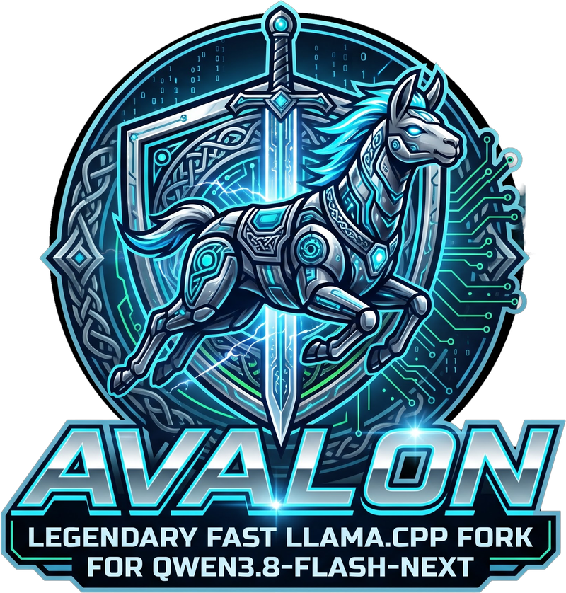

<p align="center"></p>

# Avalon

**98 tokens/s on an AMD RX 7900 XT (PCIe 3.0, Ryzen 7 3800XT, 64 GB DDR4) for Qwen3.8-Flash-Next (125B MoE).**

**16 GB of RAM is enough:** with the server capped at 14 GB, the 89 GiB model still runs at 90 tokens/s.

Avalon is a fork of [llama.cpp](https://github.com/ggml-org/llama.cpp) built for one model,
[Qwen3.8-Flash-Next](https://huggingface.co/Qwen/Qwen3.8-Flash-Next) (512 experts, 10 active, 48 layers), on one
consumer GPU with the experts in system RAM. It is not tuned on a flagship machine: every number below comes from a
desktop most people would call old.

| part | what we have | why it matters |
|---|---|---|
| CPU | **AMD Ryzen 7 3800XT** (Zen 2, Ryzen 3000 family, 2019), 8 cores | computes the experts that are not on the GPU |
| RAM | **DDR4-3200, dual channel** (33 – 35 GB/s measured), 64 GB (16 GB is enough) | every expert missing from the GPU is read from here |
| GPU | **AMD Radeon RX 7900 XT 20 GB** (RDNA3, 2022), **ROCm**, no NVIDIA, no CUDA | holds the dense weights, the KV cache and a cache of the hottest experts |
| bus | **PCIe 3.0 x16** (~14 GB/s), on a B450 board | every expert copied to the GPU goes through it |

The model is ~89 GiB; the GPU holds ~4.6 GiB of dense weights plus a cache of 9 – 14 GiB of experts, the rest stays in
RAM. **16 GB of RAM is enough**: the model is memory-mapped, and what does not fit is read again from the disk. With
the server's RAM capped at 14 GB (a 16 GB machine), the MTP best case was 90.3 t/s and 93.4 t/s after a 19k prompt
(98.99 / 98.5 uncapped, same series). With 28 GB and the GPU driver's limit on registered memory of a 32 GB machine
(both simulated), the expert arena gives 87 – 92 t/s (12 servers) and ~1,075 t/s for the prefill of a new 19k prompt.
The disk there is an NVMe SSD, a Kingston FURY Renegade (PCIe 4.0) running at PCIe 3.0, ~3 GB/s; a SATA SSD was not
measured, and with less RAM the prefill of new prompts depends on it.

## Two ideas behind Avalon

**Squeeze every last drop out of the hardware.** RAM, VRAM, CPU, PCIe link and GPU should all be busy, all the time,
at their limit. No byte of VRAM sits idle: whatever a phase does not need goes back to the expert cache. Compute
buffers are lent to the cache between phases and handed back when a graph needs them, the slots of the prefill
prefetch are borrowed from it, the end of the KV cache past the current context belongs to it until the context grows
there, and the reserve kept outside it is calculated, not guessed. The CPU computes the missing experts while the GPU
computes the cached ones. During prefill the PCIe link prefetches the next experts so the GPU hardly ever waits for
them, while during generation it carries the experts the dispatcher moves to the GPU and the cache fills.

**Optimization in partnership with an AI.** The macro optimizations, the architecture and the way the work flows
between RAM, CPU, PCIe and GPU, come from me and my 30 years of optimization work. The AI first served to build the
simulators, benchmarks and instrumented measurements that made each decision precise. Then every micro optimization,
the GPU kernels and CPU kernels above all, was written entirely by Claude Opus 5.5, with me steering. I am only the
driver; the AI is the engine, and the rest of the car.

## Speed

[IQ3_KS hybrid](https://huggingface.co/freriadoc/Qwen3.8-Flash-Next-Avalon-GGUF) (2 – 4-bit experts, perplexity close
to Unsloth's UD-IQ4_XS), greedy decoding, 512 tokens, MTP speculative decoding with 2 draft tokens; best case: mean of 3
answers, the other rows: median of 2 runs (Nov 1):

| case | generation, no MTP | generation, MTP | prefill, no MTP / MTP |
|---|---|---|---|
| 32k context, short prompt, warm cache | 66.1 t/s | **98.4 t/s** | — |
| 32k context, 32k filled | 62.3 t/s | 88.0 t/s | 1,854 / 1,680 t/s |
| 256k context, 131k filled | 60.5 t/s | 88.0 t/s | 1,693 / 1,521 t/s |
| 256k context, 250k filled | 57.3 t/s | 81.1 t/s | 1,491 / 1,342 t/s |

Missed experts that every token of a verification routes only at rank 7 or lower are skipped, as Strata does (on by
default; `GGML_CUDA_MOE_TAIL_SKIP=0` turns it off). Without it: 62.8 / 90.7 t/s on a short prompt, 51.2 / 71.0 t/s at
250k filled, prefill within 3%. GSM8K is the same with and without (see [Quality](#quality)).

The full 256k context fits with the MTP draft model, the KV cache in q8_0 / q4_0 and the expert cache, under 19.7 GiB
of VRAM.

### Same machine, Strata

With MTP, Avalon generates **44% faster than Strata** on a short prompt and 30% faster at 250k filled:

| engine | short prompt, no MTP / MTP | 256k context, 250k filled, no MTP / MTP | max prefill |
|---|---|---|---|
| **Avalon** | **66.1 / 98.4 t/s** | **57.3 / 81.1 t/s** | **1,854 t/s** |
| [Strata](https://github.com/Niko1221/Strata) v0.2.9 (HIP) | 51.1 / 68.4 t/s | 48.3 / 62.6 t/s | 1,453 t/s |

Same day, same protocol, both with the tail skip on; Strata serves ISTA's IQ3_S model, the one our experts come from,
with its own drafters on.

### NVIDIA (CUDA), one rented RTX 4090

The same code builds and runs with CUDA. Measured on one rented machine, both engines one after the other: an **RTX
4090 24 GB** in PCIe 4.0 x16, an **AMD EPYC 7443** (24 cores), MTP with 2 draft tokens (Strata: its own MTP and suffix
drafters), greedy, 512 tokens (Nov 1):

| case | Avalon | Strata v0.2.9 |
|---|---|---|
| 32k context, short prompt, MTP | **141.9 t/s** | 141.4 t/s |
| 32k context, short prompt, no MTP | 98.0 t/s | 101.5 t/s (suffix drafter only) |
| 32k context, after a 19k prompt, MTP / prefill | **137.7 t/s** / 3,113 t/s | 130.8 t/s / 3,422 t/s |
| 256k context, 128k filled, MTP / prefill | **132.6 t/s** / 3,130 t/s | 123.6 t/s / 4,312 t/s |
| 256k context, 250k filled, MTP / prefill | 123.8 t/s / 2,986 t/s | 128.5 t/s / 4,319 t/s |

VRAM peak ~23.5 GiB of 24 for both. The kernels are still tuned for RDNA3; Strata's prefill is faster on this card.

### Reported by users (not verified here)

Numbers posted by people running Avalon on their own machines, with the conditions they gave; their protocols differ
from the tables above.

| machine | what they measured |
|---|---|
| **Radeon AI PRO R9700 32 GB** (RDNA4, gfx1201), an older 6-core Xeon, 64 GB RAM, Linux | 262k context, MTP: Avalon **86.6 t/s** (85 – 93), prefill 4k / 16k / 32k 1,522 / 1,906 / 1,803 t/s; Strata on the same machine 31.0 t/s (UD-IQ4_XS; 33.8 with IQ3), prefill 988 / 1,837 / 1,872 t/s |
| **RX 7900 XTX 24 GB**, Ryzen 9 5900X, PCIe 4.0 (X570), 64 GB DDR4-3200, Linux | 131k context, `-ub 19072`, `GGML_SCHED_PREFETCH_EXPERTS=6`: prefill 2,024 – 2,043 t/s, generation 112.9 – 122.8 t/s (median 116.5); a later version with `--moe-cache-cpu-overlap 2`: prefill 2,113 – 2,130 t/s |
| **RX 7900 XTX 24 GB**, Ryzen 7 5800X3D, 64 GB RAM, **Windows 11** ([ppkrol's port](https://github.com/ppkrol/Avalon_windows)) | 32k context, MTP, the file cache warm: 83.6 – 92.2 t/s; the first requests after a start are slower while the 64 GB fill |
| **Radeon Pro W7800 48 GB** (RDNA3, 70 CUs) | one card 58 t/s without MTP, 87 with; two cards (all experts in VRAM) 46 and 70: compute-bound once the experts no longer come from RAM, not tuned for it |

The R9700 row is the first one on RDNA4: Strata's own R9700 figures come from its maintainers' machine (DDR5, PCIe 5.0,
125 – 251 GB of RAM), a different desk from this Xeon.

## Quality

Speed does not come from a smaller model. Perplexity, 8 × 4,096 tokens of external texts (*War and Peace*, *Les
Misérables*, SQLite and CPython sources; lower is better):

| quantization | English | French | code |
|---|---|---|---|
| Unsloth UD-Q4_K_XL (104 GB) | 1.316 | 3.581 | 1.325 |
| Unsloth UD-IQ4_XS | 1.401 | 3.841 | 1.343 |
| **Avalon IQ3_KS hybrid (the model above)** | **1.443** | **3.857** | **1.331** |
| ISTA GSQ-RCO IQ3_S (served by Strata above) | 1.469 | 3.932 | 1.338 |
| AtomicChat AD-4.27bpw | 1.509 | 4.073 | 1.347 |
| ISTA GSQ-RCO IQ3_XXS | 1.596 | 4.294 | 1.364 |

The hybrid keeps ISTA's experts and requantizes the up/gate tensors of 27 layers from the original BF16 weights with an
importance matrix: it beats the IQ3_S model Strata runs on all three texts and comes close to Unsloth's UD-IQ4_XS. The
KV cache in q8_0 / q4_0 adds 0.016 of KL divergence over f16 at 32 – 64k of context (same English text, measured on an
earlier quantization of the model). The MTP draft head agrees with the model on 80.7% of the positions of a fixed text (teacher-forced); in greedy
generation its acceptance follows the text: 0.55 – 0.65 on prose, up to ~0.95 on code or copied passages.

GSM8K (the first 200 problems of the test set, greedy, 4,096 tokens at most): **Avalon 196 / 200 (98.0%), Strata 196 /
200 (98.0%)** on ISTA's IQ3_S.

## What makes it fast

- **GPU expert cache** (from buun-llama-cpp), grown with the VRAM nobody else uses: compute buffers are lent to the
  cache between phases, the end of the KV cache past the current context too, and the reserve outside the cache is
  calculated (400 MiB).
- **Hosted MoE**: the GPU keeps each MoE block, computes the cached experts while the CPU computes the missing ones,
  and moves one or two missing experts to the GPU when that finishes sooner (all inside the HIP graph).
- **Expert prefetch** during prefill on 4 slots borrowed from the cache, cached experts read in place.
- **Expert arena in RAM** (buun's idea of a RAM tier under the GPU cache) when the experts do not all fit in RAM: slots
  of registered memory read from the disk with O_DIRECT instead of the page cache, part of them lent to the prefill and
  restored before generation. When they all fit, they are registered in place, loaded with O_DIRECT.
- **Sparse attention (QSA) for long contexts**: masks built on the GPU, gathered cells for generation, split kept
  across speculative steps.
- **MTP speculative decoding** with a small draft head (cut LM head over 65k frequent tokens) that shares the main
  model's expert cache.
- Fused GPU kernels for generation (a linear-attention layer went from 53 to 39 launches), AVX2 kernels for the experts on the CPU, IQ3_K / IQ3_KS types.

## Install (one command)

```bash
curl -fsSL https://raw.githubusercontent.com/freriadoc/Avalon/main/install.sh | bash
```

The installer checks the machine (Linux, AVX2, ROCm 7.x, an RDNA3 GPU, or RDNA4: reported working on a Radeon AI PRO
R9700, not measured here; 16 GB of RAM or more, ~98 GiB of disk), builds
`llama-server` for the detected GPU, downloads the model and its MTP head (~89 GiB, resumable), verifies every file
against its SHA-256 on Hugging Face and installs an `avalon-server` launcher in `~/.local/bin` with the command of
[Run](#run). Settings (environment): `AVALON_DIR`, `MODEL_DIR`, `BIN_DIR`, `AMDGPU_TARGETS`, `SKIP_MODEL=1` (build
only), `FORCE=1`; see the top of `install.sh`. Then:

```bash
avalon-server          # OpenAI-compatible API on http://127.0.0.1:8080; extra arguments go to llama-server
```

## Build (Linux, ROCm)

By hand, without the installer. Tested with ROCm 7.2.4 on gfx1100 (RX 7900 XT / XTX).

```bash
git clone https://github.com/freriadoc/Avalon && cd Avalon
cmake -B build -DGGML_HIP=ON -DAMDGPU_TARGETS=gfx1100 -DCMAKE_BUILD_TYPE=Release \
  -DCMAKE_C_COMPILER=/opt/rocm/bin/amdclang -DCMAKE_CXX_COMPILER=/opt/rocm/bin/amdclang++
cmake --build build -j$(nproc) --target llama-server
```

### Build (Linux, CUDA)

Tested with CUDA 12.4 on an RTX 4090 (`89`; set your GPU's architecture). The installer is ROCm only for now.

```bash
git clone https://github.com/freriadoc/Avalon && cd Avalon
cmake -B build -DGGML_CUDA=ON -DCMAKE_CUDA_ARCHITECTURES=89 -DCMAKE_BUILD_TYPE=Release
cmake --build build -j$(nproc) --target llama-server
```

## Run

```bash
hf download freriadoc/Qwen3.8-Flash-Next-Avalon-GGUF --local-dir Qwen3.8-Flash-Next-Avalon-GGUF
cd Qwen3.8-Flash-Next-Avalon-GGUF
../Avalon/build/bin/llama-server -m Qwen3.8-Flash-Next-Avalon-IQ3KS-00001-of-00033.gguf \
  -c 262144 -b 9536 -ub 9536 -fa on -ctk q8_0 -ctv q4_0 --jinja --parallel 1 \
  -md MTP/mtp-Qwen3.8-Flash-Next-shared-IQ3K-IQ4NL-FR65k.gguf --spec-type draft-mtp \
  --spec-draft-n-max 2 -ubd 256 -ctkd q8_0 -ctvd q8_0
```

Nothing else to set: `--fit` (on by default) places the dense weights on the GPU and the experts in RAM, the expert
cache takes the rest of the VRAM, and the cache is prefilled from `moe-cache-ranking.bin` next to the model.
`--parallel 1` matters: other slots would keep their part of the KV cache.
On NVIDIA, backend sampling is on by default: the target's argmax runs on the GPU instead of over 248k logits on the
CPU, 6% faster per step on the RTX 4090 (neutral on the RX 7900 XT, where it stays off; `-bs` / `-no-bs` force it).

### With Lemonade (untested)

[Lemonade](https://github.com/lemonade-sdk/lemonade) can run Avalon's `llama-server` in place of its own ROCm build:
start `lemond` with `LEMONADE_LLAMACPP_ROCM_BIN=/path/to/Avalon/build/bin/llama-server` (for the systemd service, in
its environment), list the model where it is with `lemonade config set extra_models_dir=/path/to/models` (the 33 parts
are one model; `lemonade list` gives its name), and give it Avalon's settings in `recipe_options.json`: `"ctx_size":
262144`, `"llamacpp_backend": "rocm"` and `"llamacpp_args": "-b 9536 -ub 9536 -fa on -ctk q8_0 -ctv q4_0 -md
/path/to/models/Qwen3.8-Flash-Next-Avalon-GGUF/MTP/mtp-Qwen3.8-Flash-Next-shared-IQ3K-IQ4NL-FR65k.gguf --spec-type
draft-mtp --spec-draft-n-max 2 -ubd 256 -ctkd q8_0 -ctvd q8_0"`. Lemonade adds the model, the context, the port,
`--jinja` and `--parallel 1` itself and no `-ngl`, so `--fit` keeps placing the model. Not tried yet: if you do, please
open an issue with what worked or not.

### Two or more GPUs (experimental, untested)

```bash
GGML_MOE_CACHE_LAYER_DEVICE=1 avalon-server   # or the llama-server command above
```

The second GPU becomes **more expert cache**, it does not split the model: the dense weights and the KV stay on the
first GPU (`--fit` puts them there), and the MoE layers are shared between the GPUs' expert caches in proportion to
their free VRAM. In generation, the MoE block of a layer runs on the GPU that caches it (only tens of KB of activations
cross per layer); the prefill and its expert prefetch stay on the first GPU. With one GPU the option changes nothing
(measured: same speed, same text).

**It has never run on two GPUs**: I have only one. If you have two RDNA3 cards, please try it and open an
issue with the server log (`-lv 4`), your GPUs and how they are connected (x16 + x4, x8 / x8...). Known gap: the
prefill only uses the first GPU's PCIe link, so with two cards in x8 / x8 slots it is probably slower than one card in x16
(a per-GPU prefetch would fix it). Without the option, several GPUs are untested too.

## Limits

- **One model.** Avalon is tuned for Qwen3.8-Flash-Next; the GGUF files above use types and a layout stock llama.cpp
  does not have. Other models run as in llama.cpp, without the expert cache work.
- **One GPU measured.** Two or more: see above, experimental and untested.
- **Tuned on RDNA3 with ROCm 7.2.** CUDA builds and was measured on rented RTX 4090s (see
  [NVIDIA](#nvidia-cuda-one-rented-rtx-4090)); its kernels are not tuned for NVIDIA yet, and the installer is ROCm only.
  RDNA4 runs ([reported](#reported-by-users-not-verified-here) on an R9700), not measured here; the chunked prompt GDN
  kernel is RDNA3-only.
- **Windows:** ported by [ppkrol](https://github.com/ppkrol/Avalon_windows) (HIP SDK 7.2, measured on a 7900 XTX, see
  [above](#reported-by-users-not-verified-here)) and merged here; a Windows installer is being tested.
- **Base:** llama.cpp master up to Oct 31, 2026 (merged that day, a few commits left out for speed or overlap).

## Credits

- [llama.cpp](https://github.com/ggml-org/llama.cpp) and the ggml authors: the base.
- [buun-llama-cpp](https://github.com/spiritbuun/buun-llama-cpp) (spiritbuun): Avalon started as a branch of buun and
  is built on its GPU expert cache and LFU admission; buun's expert heat profile recorded the shipped
  `moe-cache-ranking.bin`, and the expert arena in RAM follows buun's RAM tier of hot experts. Thank you.
- [thecodacus](https://github.com/thecodacus): the expert prefetch.
- [ik_llama.cpp](https://github.com/ikawrakow/ik_llama.cpp) (Iwan Kawrakow): the IQ3_K and IQ3_KS types, the shared
  MTP head support.
- [Strata](https://github.com/Niko1221/Strata) (Niko1221): the expert ranking format and the preload idea.
- [Unsloth](https://huggingface.co/unsloth): the MTP head we requantized.
- [ISTA-DASLab](https://huggingface.co/ISTA-DASLab), [AtomicChat](https://huggingface.co/AtomicChat),
  [drluoto / Vitronia](https://huggingface.co/drluoto): the quantizations and the FR-Spec token list our GGUF files are
  built from.
- [Qwen](https://huggingface.co/Qwen): the model.

## License

MIT, as llama.cpp. The model files are under the Qwen Community License 1.0.
