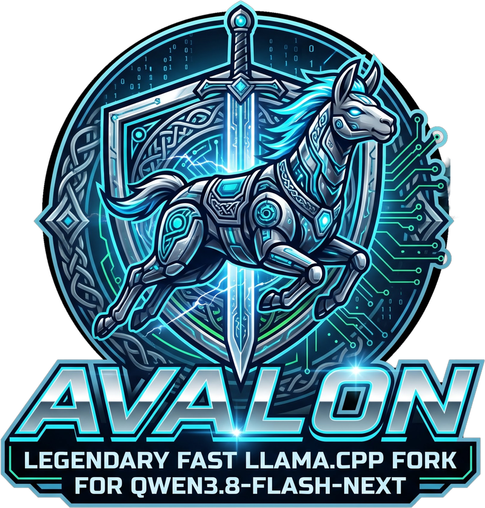

<p align="center"></p>

# Avalon

**Qwen3.8-Flash-Next (125B MoE) at 91 tokens/s on a 2019 CPU, DDR4 and an AMD card in a PCIe 3.0 slot.**

**32 GB of RAM is enough:** the 89 GiB model is bigger than RAM and VRAM combined, and still runs at 89 tokens/s.

Avalon is a fork of [llama.cpp](https://github.com/ggml-org/llama.cpp) built for one model,
[Qwen3.8-Flash-Next](https://huggingface.co/Qwen/Qwen3.8-Flash-Next) (512 experts, 10 active, 48 layers), on one
consumer GPU with the experts in system RAM. It is not tuned on a flagship machine: every number below comes from a
desktop most people would call old.

| part | what we have | why it matters |
|---|---|---|
| CPU | **AMD Ryzen 7 3800XT** (Zen 2, Ryzen 3000 family, 2019), 8 cores | computes the experts that are not on the GPU |
| RAM | **DDR4-3200, dual channel** (33 – 35 GB/s measured), 96 GB (32 GB is enough) | every expert missing from the GPU is read from here |
| GPU | **AMD Radeon RX 7900 XT 20 GB** (RDNA3, 2022), **ROCm**, no NVIDIA, no CUDA | holds the dense weights, the KV cache and a cache of the hottest experts |
| bus | **PCIe 3.0 x16** (~14 GB/s), on a B450 board | every expert copied to the GPU goes through it |

The model is ~89 GiB; the GPU holds ~4.6 GiB of dense weights plus a cache of 9 – 14 GiB of experts, the rest stays in
RAM. **32 GB of RAM is enough**: the model is memory-mapped, and what does not fit is read again from the disk. With
the server's RAM capped at 28 GB (a 32 GB machine), the MTP best case went from 91.2 to 89.0 t/s and the prefill of a new
19k prompt from 1,283 to 889 t/s; with 58 GB generation was within 5% of 96 GB.

## Two ideas behind Avalon

**Squeeze every last drop out of the hardware.** RAM, VRAM, CPU, PCIe link and GPU should all be busy, all the time,
at their limit. No byte of VRAM sits idle: whatever a phase does not need goes back to the expert cache. Compute
buffers are lent to the cache between phases and handed back when a graph needs them, the slots of the prefill
prefetch are borrowed from it, the end of the KV cache past the current context belongs to it until the context grows
there, and the reserve kept outside it is calculated, not guessed. The CPU computes the missing experts while the GPU
computes the cached ones. During prefill the PCIe link prefetches the next experts so the GPU hardly ever waits for
them, while during generation it carries the experts the dispatcher moves to the GPU and the cache fills.

**Optimization in partnership with an AI.** The macro optimizations, the architecture and the way the work flows
between RAM, CPU, PCIe and GPU, come from me and my 30 years of optimization work. The AI first served to build the
simulators, benchmarks and instrumented measurements that made each decision precise. Then every micro optimization,
the GPU kernels and CPU kernels above all, was written entirely by Claude Opus 5.5, with me steering. I am only the
driver; the AI is the engine, and the rest of the car.

## Speed

[IQ3_KS hybrid](https://huggingface.co/freriadoc/Qwen3.8-Flash-Next-Avalon-GGUF) (2 – 4-bit experts, perplexity close
to Unsloth's UD-IQ4_XS), greedy decoding, 512 tokens, median of 3 runs, MTP speculative decoding with 2 draft tokens:

| case | generation, no MTP | generation, MTP | prefill |
|---|---|---|---|
| 32k context, short prompt, warm cache | 62.4 t/s | 91.0 t/s | 1,661 t/s* |
| 256k context, 131k filled | 55.6 t/s | 74.5 t/s | 1,496 t/s |
| 256k context, 250k filled | 50.5 t/s | 69.8 t/s | 1,376 t/s |

\* Maximum prefill, measured with a 32k prompt filling the 32k context. Prefill figures are without MTP (with MTP:
1,544 / 1,387 / 1,273 t/s).

The full 256k context fits with the MTP draft model, the KV cache in q8_0 / q4_0 and the expert cache, under 19.7 GiB
of VRAM.

### Same machine, Strata

With MTP, Avalon generates **almost 50% faster than Strata at equivalent quantization** (+47% for short prompt):

| engine | generation, short prompt, no MTP / MTP | 256k context, 250k filled, no MTP / MTP | max prefill |
|---|---|---|---|
| **Avalon** | **62.4 / 91.0 t/s** | **50.5 / 69.8 t/s** | **1,661 t/s** |
| [Strata](https://github.com/Niko1221/Strata) 0.1.43 (HIP) | 49.0 / 61.9 t/s | 41.8 / 50.0 t/s | 1,376 t/s |

Measured the same night with the same protocol; Strata serves ISTA's IQ3_S model, the one our experts come from, with
its own drafters on.

### NVIDIA (CUDA), one rented RTX 4090

The same code builds and runs with CUDA. Measured once, on a rented cloud machine: an **RTX 4090 24 GB** in PCIe 4.0
x16, an **AMD EPYC 7352** (Zen 2, 24 cores, the container capped at ~20 of them, 1.5 – 2.3 GHz), CUDA 12.4, the
same model and launcher plus `-bs` (the verification's argmax on the GPU, see [Run](#run)), MTP with 2 draft tokens,
greedy, 512 tokens:

| case | generation, MTP | prefill |
|---|---|---|
| 32k context, short prompt, warm cache | **120.5 t/s** (mean of 5 answers, 114.5 – 125.4) | — |
| 32k context, after a 19k prompt | 110.6 t/s | 1,819 – 2,330 t/s |
| 256k context, 131k filled | 106.6 t/s | 2,242 t/s |
| 256k context, 250k filled | **99.5 t/s** | 2,280 t/s |

One run per row (not medians), VRAM peak 22.9 GiB of 24. Generation without MTP was not measured there. It is a
first measurement on a machine I do not own, not a tuned result: the kernels are still tuned for RDNA3.

## Quality

Speed does not come from a smaller model. Perplexity, 8 × 4,096 tokens of external texts (*War and Peace*, *Les
Misérables*, SQLite and CPython sources; lower is better):

| quantization | English | French | code |
|---|---|---|---|
| Unsloth UD-Q4_K_XL (104 GB) | 1.316 | 3.581 | 1.325 |
| Unsloth UD-IQ4_XS | 1.401 | 3.841 | 1.343 |
| **Avalon IQ3_KS hybrid (the model above)** | **1.443** | **3.857** | **1.331** |
| ISTA GSQ-RCO IQ3_S (served by Strata above) | 1.469 | 3.932 | 1.338 |
| AtomicChat AD-4.27bpw | 1.509 | 4.073 | 1.347 |
| ISTA GSQ-RCO IQ3_XXS | 1.596 | 4.294 | 1.364 |

The hybrid keeps ISTA's experts and requantizes the up/gate tensors of 27 layers from the original BF16 weights with an
importance matrix: it beats the IQ3_S model Strata runs on all three texts and comes close to Unsloth's UD-IQ4_XS. The
KV cache in q8_0 / q4_0 adds 0.016 of KL divergence over f16 at 32 – 64k of context (same English text, measured on an
earlier quantization of the model). The MTP draft head agrees with the model on 80.7% of the positions of a fixed text.

## What makes it fast

- **GPU expert cache** (from buun-llama-cpp), grown with the VRAM nobody else uses: compute buffers are lent to the
  cache between phases, the end of the KV cache past the current context too, and the reserve outside the cache is
  calculated (400 MiB).
- **Hosted MoE**: the GPU keeps each MoE block, computes the cached experts while the CPU computes the missing ones,
  and moves one or two missing experts to the GPU when that finishes sooner (all inside the HIP graph).
- **Expert prefetch** during prefill on 4 slots borrowed from the cache, cached experts read in place.
- **Sparse attention (QSA) for long contexts**: masks built on the GPU, gathered cells for generation, split kept
  across speculative steps.
- **MTP speculative decoding** with a small draft head (cut LM head over 65k frequent tokens) that shares the main
  model's expert cache.
- Fused GPU kernels for generation (a linear-attention layer went from 53 to 39 launches), AVX2 kernels for the experts on the CPU, IQ3_K / IQ3_KS types.

## Install (one command)

```bash
curl -fsSL https://raw.githubusercontent.com/freriadoc/Avalon/main/install.sh | bash
```

The installer checks the machine (Linux, AVX2, ROCm 7.x, an RDNA3 GPU, 32 GB of RAM or more, ~98 GiB of disk), builds
`llama-server` for the detected GPU, downloads the model and its MTP head (~89 GiB, resumable), verifies every file
against its SHA-256 on Hugging Face and installs an `avalon-server` launcher in `~/.local/bin` with the command of
[Run](#run). Settings (environment): `AVALON_DIR`, `MODEL_DIR`, `BIN_DIR`, `AMDGPU_TARGETS`, `SKIP_MODEL=1` (build
only), `FORCE=1`; see the top of `install.sh`. Then:

```bash
avalon-server          # OpenAI-compatible API on http://127.0.0.1:8080; extra arguments go to llama-server
```

## Build (Linux, ROCm)

By hand, without the installer. Tested with ROCm 7.2.4 on gfx1100 (RX 7900 XT / XTX).

```bash
git clone https://github.com/freriadoc/Avalon && cd Avalon
cmake -B build -DGGML_HIP=ON -DAMDGPU_TARGETS=gfx1100 -DCMAKE_BUILD_TYPE=Release \
  -DCMAKE_C_COMPILER=/opt/rocm/bin/amdclang -DCMAKE_CXX_COMPILER=/opt/rocm/bin/amdclang++
cmake --build build -j$(nproc) --target llama-server
```

### Build (Linux, CUDA)

Tested with CUDA 12.4 on an RTX 4090 (`89`; set your GPU's architecture). The installer is ROCm only for now.

```bash
git clone https://github.com/freriadoc/Avalon && cd Avalon
cmake -B build -DGGML_CUDA=ON -DCMAKE_CUDA_ARCHITECTURES=89 -DCMAKE_BUILD_TYPE=Release
cmake --build build -j$(nproc) --target llama-server
```

## Run

```bash
hf download freriadoc/Qwen3.8-Flash-Next-Avalon-GGUF --local-dir Qwen3.8-Flash-Next-Avalon-GGUF
cd Qwen3.8-Flash-Next-Avalon-GGUF
../Avalon/build/bin/llama-server -m Qwen3.8-Flash-Next-Avalon-IQ3KS-00001-of-00033.gguf \
  -c 262144 -b 9536 -ub 9536 -fa on -ctk q8_0 -ctv q4_0 --jinja --parallel 1 \
  -md MTP/mtp-Qwen3.8-Flash-Next-shared-IQ3K-IQ4NL-FR65k.gguf --spec-type draft-mtp \
  --spec-draft-n-max 2 -ubd 256 -ctkd q8_0 -ctvd q8_0
```

Nothing else to set: `--fit` (on by default) places the dense weights on the GPU and the experts in RAM, the expert
cache takes the rest of the VRAM, and the cache is prefilled from `moe-cache-ranking.bin` next to the model.
`--parallel 1` matters: other slots would keep their part of the KV cache.
On NVIDIA, add `-bs`: the target's argmax then runs on the GPU instead of over 248k logits on the CPU, 6% faster per
step on the RTX 4090 (neutral on the RX 7900 XT).

### Two or more GPUs (experimental, untested)

```bash
GGML_MOE_CACHE_LAYER_DEVICE=1 avalon-server   # or the llama-server command above
```

The second GPU becomes **more expert cache**, it does not split the model: the dense weights and the KV stay on the
first GPU (`--fit` puts them there), and the MoE layers are shared between the GPUs' expert caches in proportion to
their free VRAM. In generation, the MoE block of a layer runs on the GPU that caches it (only tens of KB of activations
cross per layer); the prefill and its expert prefetch stay on the first GPU. With one GPU the option changes nothing
(measured: same speed, same text).

**It has never run on two GPUs**: I have only one. If you have two RDNA3 cards, please try it and open an
issue with the server log (`-lv 4`), your GPUs and how they are connected (x16 + x4, x8 / x8...). Known gap: the
prefill only uses the first GPU's PCIe link, so with two cards in x8 / x8 slots it is probably slower than one card in x16
(a per-GPU prefetch would fix it). Without the option, several GPUs are untested too.

## Limits

- **One model.** Avalon is tuned for Qwen3.8-Flash-Next; the GGUF files above use types and a layout stock llama.cpp
  does not have. Other models run as in llama.cpp, without the expert cache work.
- **One GPU measured.** Two or more: see above, experimental and untested.
- **Tuned on RDNA3 with ROCm 7.2.** CUDA builds and was measured once, on a rented RTX 4090 (see
  [NVIDIA](#nvidia-cuda-one-rented-rtx-4090)); its kernels are not tuned for NVIDIA yet, and the installer is ROCm only.
  Windows is untested.
- **Base:** llama.cpp master of Oct 3, 2026, plus the commits of Oct 3 – 11 picked one by one; later master changes
  are not in.

## Credits

- [llama.cpp](https://github.com/ggml-org/llama.cpp) and the ggml authors: the base.
- [buun-llama-cpp](https://github.com/spiritbuun/buun-llama-cpp) (spiritbuun): Avalon started as a branch of buun and
  is built on its GPU expert cache and LFU admission; buun's expert heat profile recorded the shipped
  `moe-cache-ranking.bin`. Thank you.
- [thecodacus](https://github.com/thecodacus): the expert prefetch.
- [ik_llama.cpp](https://github.com/ikawrakow/ik_llama.cpp) (Iwan Kawrakow): the IQ3_K and IQ3_KS types, the shared
  MTP head support.
- [Strata](https://github.com/Niko1221/Strata) (Niko1221): the expert ranking format and the preload idea.
- [Unsloth](https://huggingface.co/unsloth): the MTP head we requantized.
- [ISTA-DASLab](https://huggingface.co/ISTA-DASLab), [AtomicChat](https://huggingface.co/AtomicChat),
  [drluoto / Vitronia](https://huggingface.co/drluoto): the quantizations and the FR-Spec token list our GGUF files are
  built from.
- [Qwen](https://huggingface.co/Qwen): the model.

## License

MIT, as llama.cpp. The model files are under the Qwen Community License 1.0.
